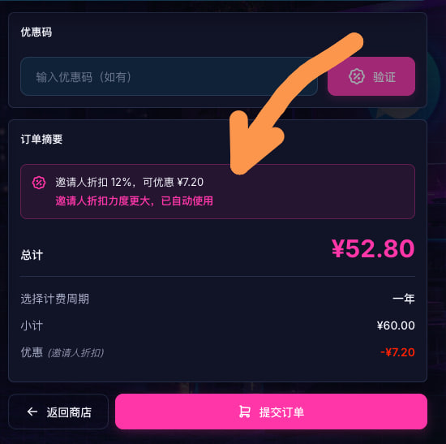
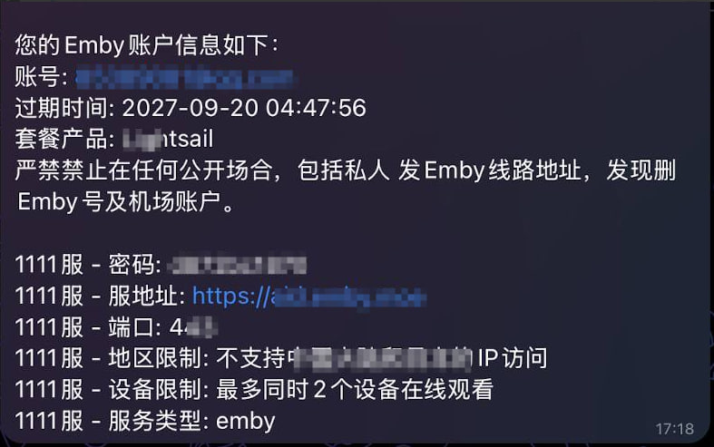
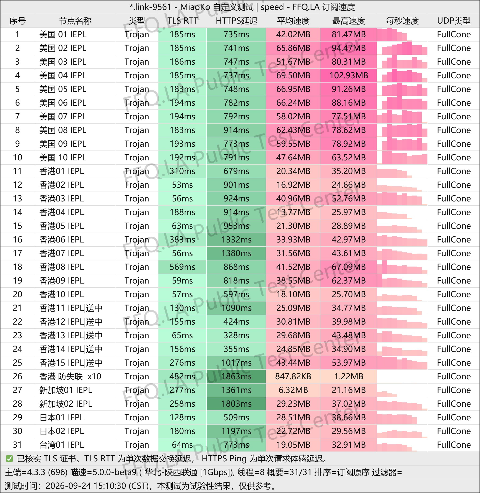
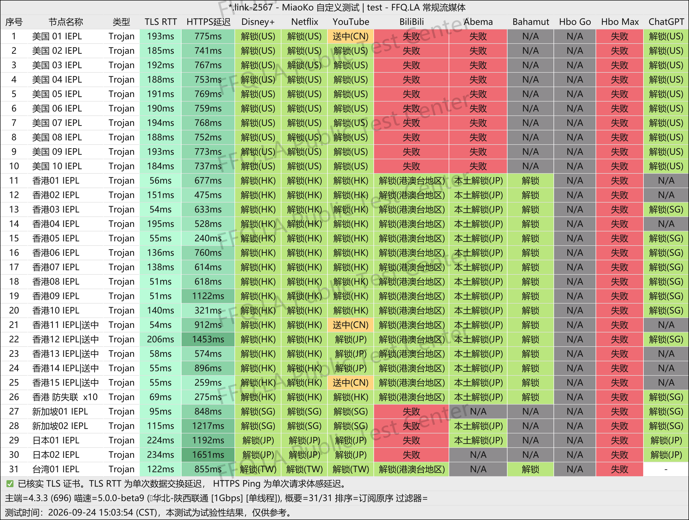
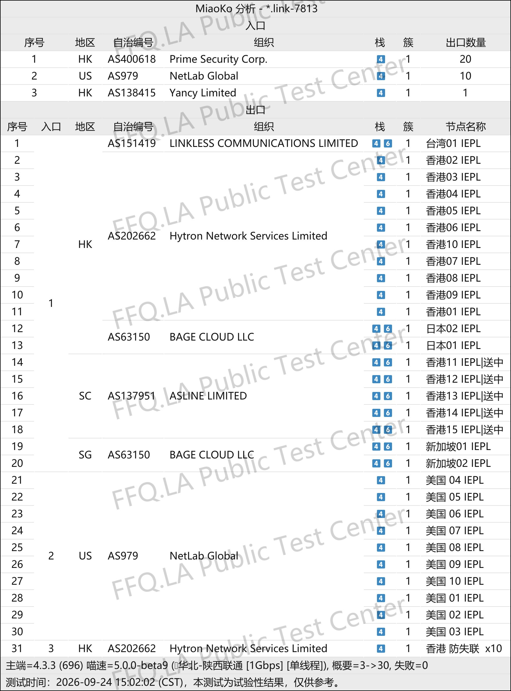

🇨🇳 [中文](README.md) | 🇺🇸 English | 🇷🇺 [Русский](README_RU.md) | 🇮🇷 [فارسی](README_FA.md)

# KooDog VPN Official Website (Updated November 11, 2026)

KooDog VPN Official Website<br>
Official Website: [www.kdcloud.uk](https://to.iix.im/kg01)<br>

2026 Best VPN Recommendations and Proxy Node Sharing: [https://github.com/jdnei/JiChangTuiJian](https://github.com/jdnei/JiChangTuiJian)<br>

## Telegram VPN Community #AD

[VPN Giveaway Group](https://331024.de/archives/choujiang) | [VPN Chat Group](https://331024.de/archives/choujiang) | [VPN Trial Group](https://331024.de/archives/choujiang)<br>

[https://331024.de/archives/choujiang](https://331024.de/archives/choujiang)

## Invitation Code

```bash
Q67JjGjy
```

## Coupon Code / Discount

`12% OFF when registering with the invitation code.`<br>

<br>

## Introduction

KooDog VPN is an affordable network acceleration service focused on providing stable connections and flexible subscription options.

It offers multiple traffic allowances to accommodate light internet usage, everyday browsing, streaming entertainment, and high-volume data requirements.

With low entry-level pricing, nodes in popular regions, and continuous improvements to network stability and connection speeds, KooDog is suitable for use as either a primary VPN or a backup service.

## Advantages

KooDog VPN offers competitive pricing, flexible subscription plans, and relatively low entry costs.

The service supports **dedicated network lines** designed to balance connection speed and stability.

Selected plans support access to popular streaming services, while multiple traffic allowances accommodate both light and heavy users.

In addition to basic VPN subscriptions, certain plans include `Emby streaming access` and `unused traffic rollover`.

Users can also benefit from reduced traffic consumption multipliers during designated off-peak hours.

## Subscription Plans

| Plan | Traffic | Monthly | Quarterly | 6 Months | 1 Year | 2 Years | 3 Years | Non-Expiring | Simultaneous IPs | Traffic Reset | Speed Limit | Network | Emby | Adult Content | Check-in Rewards | Off-Peak Discount | Traffic Rollover |
|---|---:|---:|---:|---:|---:|---:|---:|---:|---|---|---|---|---|---|---|---|---|
| Edge Lightsail | 15 GB | ¥5 | ¥15 | ¥30 | ¥60 | ¥120 | ¥180 | — | Unlimited | 1st of each month | Unlimited | BGP international dedicated lines | ❌ | ✅ | ❌ | ✅ | ❌ |
| Lightsail | 50 GB | ¥16 | ¥48 | ¥96 | ¥192 | ¥384 | ¥576 | — | Unlimited | 1st of each month | Unlimited | BGP international dedicated lines | ✅ | ✅ | 1–500M | ✅ | ✅ |
| Lite | 100 GB | ¥32 | ¥96 | ¥192 | ¥384 | ¥768 | ¥1152 | — | Unlimited | 1st of each month | Unlimited | BGP international dedicated lines | ✅ | ✅ | 1–1000M | ✅ | ✅ |
| Basic | 200 GB | ¥62 | ¥186 | ¥372 | ¥744 | ¥1488 | ¥2232 | — | Unlimited | 1st of each month | Unlimited | BGP international dedicated lines | ✅ | ✅ | 1–2000M | ✅ | ✅ |
| Premium | 300 GB | ¥88 | ¥264 | ¥528 | ¥1056 | ¥2112 | ¥3168 | — | Unlimited | 1st of each month | Unlimited | BGP international dedicated lines | ✅ | ✅ | 1–3000M | ✅ | ✅ |
| Pro | 500 GB | ¥138 | ¥414 | ¥828 | ¥1656 | ¥3312 | ¥4968 | — | Unlimited | 1st of each month | Unlimited | BGP international dedicated lines | ✅ | ✅ | 1–4000M | ✅ | ✅ |
| Custom | 9,999 GB | — | — | — | — | — | — | ¥9999 | Unlimited | 1st of each month | Unlimited | BGP international dedicated lines | ✅ | ✅ | 1–4000M | ✅ | ✅ |

**Not available in Xinjiang, Tibet, Inner Mongolia, or campus networks.**

## Time-Based Traffic Multipliers

🧪 **Reduced Traffic Multipliers During Selected Hours | Nodes Now Available**

### ⏱️ Traffic Billing Multipliers (Beijing Time, UTC+8)

| Time Period | Traffic Multiplier |
|---|---:|
| 02:00–08:00 | 0.1× |
| 08:00–16:00 | 0.5× |
| 16:00–02:00 the following day | 1.0× |

### 🧮 Examples

- Using **1 GB** of proxy traffic between **02:00 and 08:00** consumes only **0.1 GB** of the subscription allowance.
- Using **1 GB** of proxy traffic between **08:00 and 16:00** consumes only **0.5 GB** of the subscription allowance.

> ℹ️ These multipliers apply only to nodes in **Hong Kong, Singapore, Japan, the United States, and Taiwan**. Multipliers are used for traffic billing, and the actual system calculation takes precedence. Any adjustments will be announced on the official website.

## Traffic Rollover System

### 🔄 What Is Traffic Rollover?

Unused subscription traffic from the previous month can be **carried over** to the following month, extending its usability for another billing period.

### 🚀 Traffic Rollover System

- When a subscription **expires**, any remaining traffic balance is lost. After purchasing or renewing a subscription, traffic rollover begins **the following month**.
- All recurring subscription plans reset their traffic allowances on the **1st day of every month**, regardless of the original purchase date.
- Plans that **do not include the "Traffic Rollover" benefit** cannot carry unused traffic forward, but their allowances still reset on the 1st of each month.

### 🧮 Examples

#### January

Subscription allowance: **100 GB**

Unused traffic: **50 GB**

→ **Available on February 1: 150 GB**

#### February

If no traffic is used in February:

- The **50 GB carried over from January expires**.
- The **100 GB allocated for February remains unused**.

→ **Available on March 1: 200 GB**

#### March

Total available traffic: **200 GB**

- Monthly base allowance: **100 GB**
- Unused traffic carried over from February: **100 GB**

> ℹ️ Carried-over traffic remains valid only for **the following month**. Traffic rolled over from earlier months expires. Actual system calculations take precedence, and any changes will be announced on the official website.

## Emby Guide

<br>

<br>

### 🎬 @GreatEmby_bot | Emby Management Bot & Recommended Players

### 🤖 Bot Instructions

1. Use `/synchronizer` to synchronize all Emby services connected to KooDog.
2. Use `/info` to view your login information.
3. If synchronization fails, submit a support ticket with the error details.
4. Playback usually requires **3–10 seconds** of initial buffering. Please wait patiently.

### ⚠️ Important Notes

- A password displayed as `None` means you can log in without a password.
- A **401** error indicates an incorrect password. Use `/resetpassword` to change it.
- A **403** error indicates a regional restriction. Use `/info` to check the server's regional access restrictions.
- If your subscription is still active but the library appears empty, run `/synchronizer` to refresh your permissions and media library.

### ⛔ Prohibited Players (Do Not Use)

- Baomihua (爆米花)
- Vidhub
- Infuse in "Media Library Mode"
- Reflix
- Emby for Kodi login

### ⬇️ Player Downloads

> Select **"Emby"** or **"Other Emby"** as the connection protocol.

### 🍎 Community Recommendations (Apple Devices)

- **SenPlayer:** Recommended paid option for Apple devices. The base application is free, with in-app purchases.
- **Infuse:** Available across Apple platforms with excellent decoding capabilities. Make sure to disable "Server Mode" when adding an Emby connection.
- **Conflux:** Currently free and available on multiple platforms. A useful alternative to Infuse.

### 🤖 Recommended Players (Android / Windows)

- **Hills:** Free base application with in-app purchases. The free version has relatively few restrictions and supports basic playback.
- Windows users can search for and download it directly from the Microsoft Store.
- Android users can download it from Google Play or its official channel.

### 📱 iOS / iPadOS

- **Infuse** → [**Download**](https://apps.apple.com/cn/app/id1136220934)
- **yybx** → [**Download**](https://apps.apple.com/cn/app/yybx/id1519723194)
- **iemc** → [**Download**](https://apps.apple.com/cn/app/iemc/id1467462861)
- **Fileball** → [**Download**](https://apps.apple.com/cn/app/fileball/id1558391784)
- **HamHub** → [**Download**](https://apps.apple.com/cn/app/id6458691598)
- **SenPlayer** → [**Download**](https://apps.apple.com/cn/app/id6443975850)
- **Conflux** → [**Download**](https://apps.apple.com/cn/app/conflux-video-player/id6450330892)
- **iPlay** → [**Download**](https://apps.apple.com/cn/app/iplay/id6480576133)
- **Forward** → [**Download**](https://apps.apple.com/us/app/forward-%E6%96%B0%E8%A7%86%E7%95%8C/id6503940939)

### 📺 Apple TV

- **Infuse** → [**Download**](https://apps.apple.com/cn/app/id1136220934)
- **yybx** → [**Download**](https://apps.apple.com/cn/app/yybx/id1519723194)
- **Fileball** → [**Download**](https://apps.apple.com/cn/app/fileball/id1558391784)
- **HamHub** → [**Download**](https://apps.apple.com/cn/app/id6458691598)
- **SenPlayer** → [**Download**](https://apps.apple.com/cn/app/id6443975850)
- **Conflux** → [**Download**](https://apps.apple.com/cn/app/conflux-video-player/id6450330892)
- **iPlay** → [**Download**](https://apps.apple.com/cn/app/iplay/id6480576133)

### 🤖 Android

- **Afusekt** → [**Download**](https://github.com/AttemptD/AfuseKt-release/releases)
- **Yamby** → [**Download**](https://t.me/yamby_release)
- **Emby Xiaomi Version / Modified Versions Collection** → [**Download**](https://t.me/NaoRubbish/119)
- **iPlay** → [**Download**](https://github.com/ourfor/iPlay/releases)
- **Jellyfin** → [**Download**](https://play.google.com/store/apps/details?id=org.jellyfin.mobile&hl=en_US)
- **Findroid** → [**Download**](https://play.google.com/store/apps/details?id=dev.jdtech.jellyfin&hl=en_US)
- **Emby kirlif Version** → [**Download**](https://t.me/SaltSoupGarage/603)
- **Femor** → [**Download**](https://t.me/hkaemby/38362)

### 📺 Android TV

- **Afusekt TV** → [**Download**](https://github.com/AttemptD/AfuseKtV-release/releases)
- **Jellyfin Android TV** → [**Download**](https://github.com/jellyfin/jellyfin-androidtv/releases)
- **Emby Xiaomi Version / Modified Versions Collection** → [**Download**](https://t.me/NaoRubbish/119)
- **Emby kirlif Version** → [**Download**](https://t.me/SaltSoupGarage/615)

### 🖥️ Windows

- **Jellyfin Media Player** → [**Download**](https://github.com/jellyfin/jellyfin-media-player/releases)
- **Emby Xiaomi Version / Modified Versions Collection** → [**Download**](https://t.me/NaoRubbish/119)
- **Tsukimi** → [**Download**](https://github.com/tsukinaha/tsukimi/releases)
- **Femor** → [**Download**](https://t.me/hkaemby/38362)

> 💡 Compatibility varies significantly between devices and modified application versions. Try several players and choose the one that works best on your device.

## 📊 Performance Tests and Analysis

#### 1. Evening Peak-Hour Speed Test

<br>

#### 2. Streaming Platform Unblocking Report

<br>

#### 3. Entry and Exit Node Analysis

<br>
