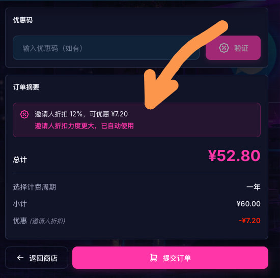
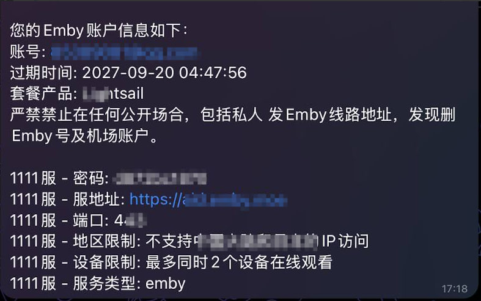
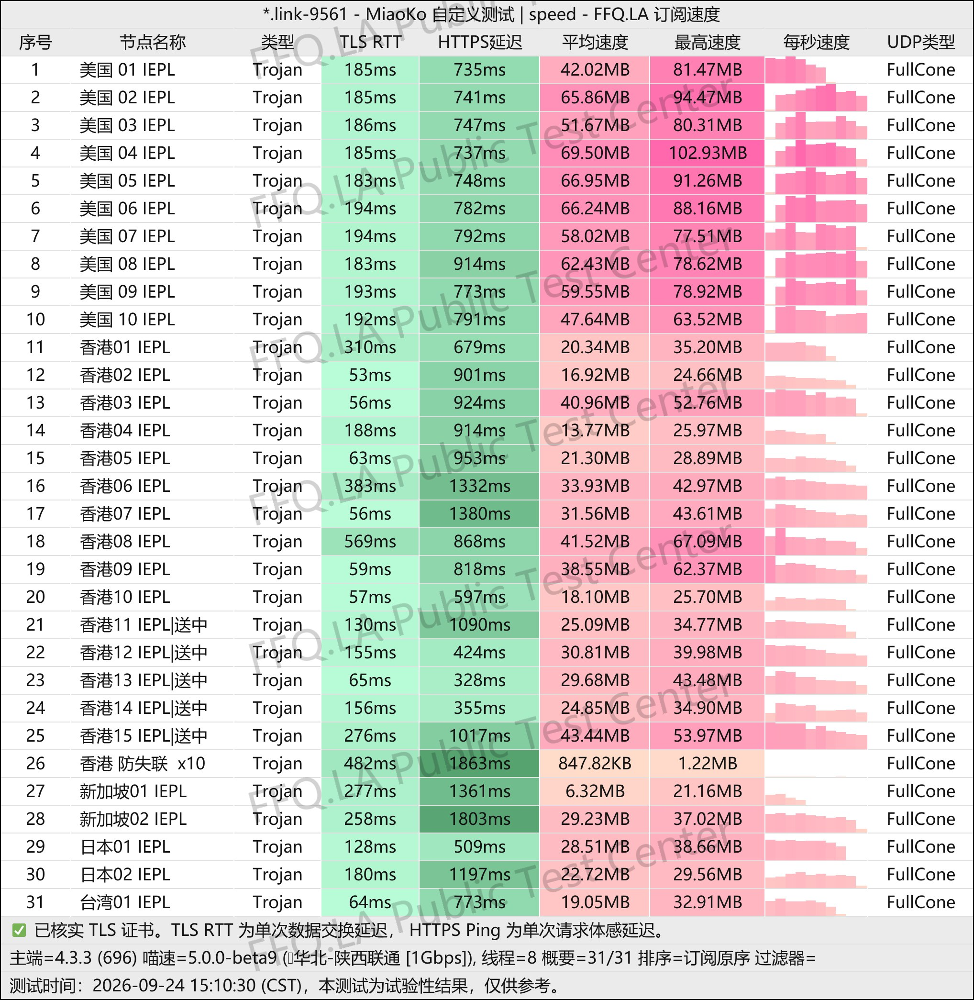
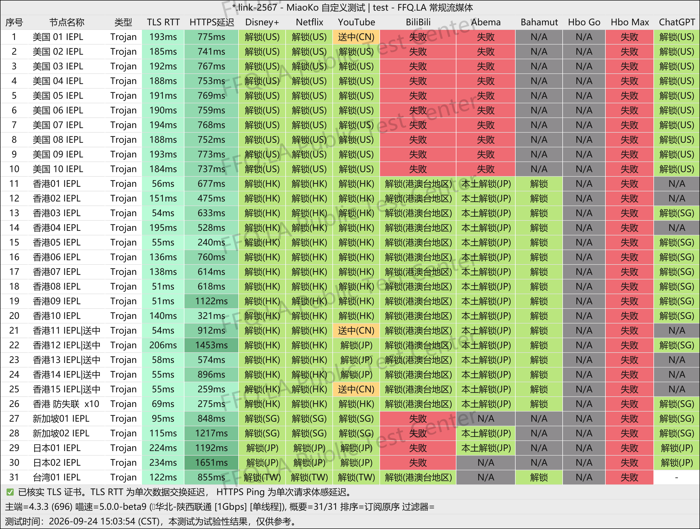
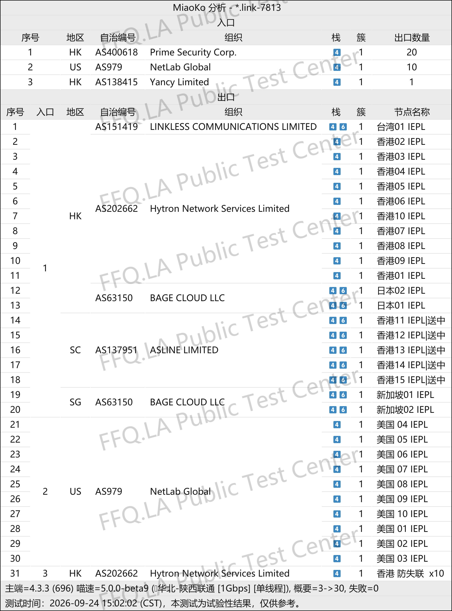

 🇨🇳 [中文](README.md) | 🇺🇸 [English](README_EN.md) | 🇷🇺 [Русский](README_RU.md) | 🇮🇷 فارسی

# وب‌سایت رسمی فیلترشکن KooDog (به‌روزرسانی: ۳ نوامبر ۲۰۲۶)

وب‌سایت رسمی فیلترشکن KooDog<br>
آدرس رسمی: [www.kdcloud.uk](https://to.iix.im/kg01)<br>

معرفی بهترین سرویس‌های VPN و اشتراک‌گذاری سرورهای پروکسی در سال ۲۰۲۶: [https://github.com/jdnei/JiChangTuiJian](https://github.com/jdnei/JiChangTuiJian)<br>

## انجمن تلگرامی VPN #AD

[گروه قرعه‌کشی VPN](https://331024.de/archives/choujiang) | [گروه گفت‌وگوی VPN](https://331024.de/archives/choujiang) | [گروه تست VPN](https://331024.de/archives/choujiang)<br>

[https://331024.de/archives/choujiang](https://331024.de/archives/choujiang)

## کد دعوت

```bash
Q67JjGjy
```

## کد تخفیف

`۱۲٪ تخفیف در صورت ثبت‌نام با کد دعوت`<br>

<br>

## معرفی

KooDog یک سرویس VPN مقرون‌به‌صرفه است که بر اتصال پایدار و ارائه طرح‌های اشتراک متنوع تمرکز دارد.

این سرویس بسته‌های مختلفی با حجم ترافیک متفاوت ارائه می‌دهد که برای استفاده سبک، وب‌گردی روزمره، تماشای محتوای آنلاین و مصرف بالای اینترنت مناسب هستند.

قیمت اولیه پایین، پوشش سرورها در مناطق پرطرفدار و بهینه‌سازی مداوم سرعت و پایداری اتصال، KooDog را به گزینه‌ای برای استفاده به‌عنوان VPN اصلی یا پشتیبان تبدیل کرده است.

## مزایا

KooDog از قیمت مناسب، طرح‌های اشتراک انعطاف‌پذیر و هزینه شروع پایین برخوردار است.

این سرویس از **خطوط اختصاصی شبکه** برای ایجاد تعادل میان سرعت و پایداری استفاده می‌کند.

برخی طرح‌ها از رفع محدودیت سرویس‌های پخش آنلاین پشتیبانی می‌کنند و حجم‌های مختلف ترافیک برای کاربران کم‌مصرف و پرمصرف در دسترس هستند.

علاوه بر خدمات پایه VPN، بعضی طرح‌ها شامل `امکانات تماشای Emby` و `انتقال ترافیک مصرف‌نشده به ماه بعد` هستند.

همچنین کاربران می‌توانند در ساعات مشخص کم‌مصرف، از ضریب محاسبه ترافیک پایین‌تر بهره‌مند شوند.

## طرح‌های اشتراک

| طرح | ترافیک | ماهانه | سه‌ماهه | شش‌ماهه | یک‌ساله | دوساله | سه‌ساله | بدون محدودیت زمانی | IPهای آنلاین هم‌زمان | بازنشانی ترافیک | محدودیت سرعت | نوع اتصال | Emby | محتوای بزرگسالان | پاداش ورود روزانه | ضریب کمتر در ساعات خلوت | انتقال ترافیک |
|---|---:|---:|---:|---:|---:|---:|---:|---:|---|---|---|---|---|---|---|---|---|
| Edge Lightsail | 15 گیگابایت | ¥5 | ¥15 | ¥30 | ¥60 | ¥120 | ¥180 | — | نامحدود | روز اول هر ماه | بدون محدودیت | خطوط اختصاصی بین‌المللی BGP | ❌ | ✅ | ❌ | ✅ | ❌ |
| Lightsail | 50 گیگابایت | ¥16 | ¥48 | ¥96 | ¥192 | ¥384 | ¥576 | — | نامحدود | روز اول هر ماه | بدون محدودیت | خطوط اختصاصی بین‌المللی BGP | ✅ | ✅ | 1–500M | ✅ | ✅ |
| Lite | 100 گیگابایت | ¥32 | ¥96 | ¥192 | ¥384 | ¥768 | ¥1152 | — | نامحدود | روز اول هر ماه | بدون محدودیت | خطوط اختصاصی بین‌المللی BGP | ✅ | ✅ | 1–1000M | ✅ | ✅ |
| Basic | 200 گیگابایت | ¥62 | ¥186 | ¥372 | ¥744 | ¥1488 | ¥2232 | — | نامحدود | روز اول هر ماه | بدون محدودیت | خطوط اختصاصی بین‌المللی BGP | ✅ | ✅ | 1–2000M | ✅ | ✅ |
| Premium | 300 گیگابایت | ¥88 | ¥264 | ¥528 | ¥1056 | ¥2112 | ¥3168 | — | نامحدود | روز اول هر ماه | بدون محدودیت | خطوط اختصاصی بین‌المللی BGP | ✅ | ✅ | 1–3000M | ✅ | ✅ |
| Pro | 500 گیگابایت | ¥138 | ¥414 | ¥828 | ¥1656 | ¥3312 | ¥4968 | — | نامحدود | روز اول هر ماه | بدون محدودیت | خطوط اختصاصی بین‌المللی BGP | ✅ | ✅ | 1–4000M | ✅ | ✅ |
| سفارشی | 9,999 گیگابایت | — | — | — | — | — | — | ¥9999 | نامحدود | روز اول هر ماه | بدون محدودیت | خطوط اختصاصی بین‌المللی BGP | ✅ | ✅ | 1–4000M | ✅ | ✅ |

**این سرویس در سین‌کیانگ، تبت، مغولستان داخلی و شبکه‌های دانشگاهی قابل استفاده نیست.**

## ضریب مصرف ترافیک بر اساس ساعت

🧪 **ضریب مصرف کمتر در ساعات مشخص | سرورهای مربوطه فعال هستند**

### ⏱️ ضریب محاسبه ترافیک (به وقت پکن، UTC+8)

| بازه زمانی | ضریب محاسبه ترافیک |
|---|---:|
| 02:00–08:00 | 0.1× |
| 08:00–16:00 | 0.5× |
| 16:00–02:00 روز بعد | 1.0× |

### 🧮 مثال‌ها

- اگر بین ساعت **02:00 تا 08:00** مقدار **1 گیگابایت** ترافیک پروکسی مصرف کنید، فقط **0.1 گیگابایت** از سهمیه شما کسر می‌شود.
- اگر بین ساعت **08:00 تا 16:00** مقدار **1 گیگابایت** ترافیک پروکسی مصرف کنید، فقط **0.5 گیگابایت** از سهمیه شما کسر می‌شود.

> ℹ️ این قانون فقط برای سرورهای **Hong Kong، Singapore، Japan، United States و Taiwan** اعمال می‌شود. ضریب‌ها برای محاسبه مصرف ترافیک استفاده می‌شوند و محاسبات واقعی سیستم ملاک نهایی است. هرگونه تغییر در وب‌سایت رسمی اعلام خواهد شد.

## سیستم انتقال ترافیک باقی‌مانده

### 🔄 انتقال ترافیک چیست؟

ترافیک استفاده‌نشده اشتراک در ماه قبل می‌تواند به **ماه بعد منتقل شود** و اعتبار استفاده از آن برای یک دوره دیگر تمدید گردد.

### 🚀 سیستم انتقال ترافیک

- پس از **انقضای اشتراک**، ترافیک باقی‌مانده از بین می‌رود. پس از خرید مجدد یا تمدید اشتراک، قابلیت انتقال ترافیک از **ماه بعد** فعال می‌شود.
- ترافیک تمام اشتراک‌های دوره‌ای در **روز اول هر ماه** بازنشانی می‌شود و تاریخ خرید تأثیری بر آن ندارد.
- اگر در توضیحات یک طرح، گزینه **«انتقال ترافیک» فعال نباشد**، ترافیک استفاده‌نشده به ماه بعد منتقل نمی‌شود؛ با این حال، سهمیه آن همچنان در روز اول هر ماه بازنشانی خواهد شد.

### 🧮 مثال‌ها

#### ژانویه

حجم اشتراک: **100 گیگابایت**

ترافیک باقی‌مانده: **50 گیگابایت**

→ **حجم قابل استفاده در ۱ فوریه: 150 گیگابایت**

#### فوریه

اگر در ماه فوریه هیچ ترافیکی مصرف نشود:

- **50 گیگابایت منتقل‌شده از ژانویه منقضی می‌شود.**
- **100 گیگابایت سهمیه فوریه مصرف‌نشده باقی می‌ماند.**

→ **حجم قابل استفاده در ۱ مارس: 200 گیگابایت**

#### مارس

کل حجم قابل استفاده: **200 گیگابایت**

- سهمیه پایه ماهانه: **100 گیگابایت**
- ترافیک باقی‌مانده و منتقل‌شده از فوریه: **100 گیگابایت**

> ℹ️ ترافیک منتقل‌شده فقط در **ماه بعد** اعتبار دارد. ترافیک منتقل‌شده از ماه‌های قدیمی‌تر منقضی می‌شود. محاسبات واقعی سیستم ملاک نهایی است و تغییرات احتمالی در وب‌سایت رسمی اعلام خواهد شد.

## راهنمای Emby

<br>

<br>

### 🎬 @GreatEmby_bot | ربات مدیریت Emby و معرفی پخش‌کننده‌ها

### 🤖 راهنمای استفاده از ربات

1. از دستور `/synchronizer` برای همگام‌سازی تمام سرویس‌های Emby متصل به KooDog استفاده کنید.
2. سپس با دستور `/info` اطلاعات ورود خود را مشاهده کنید.
3. در صورت ناموفق بودن همگام‌سازی، یک تیکت پشتیبانی همراه با جزئیات خطا ارسال کنید.
4. شروع پخش معمولاً به **۳ تا ۱۰ ثانیه** بارگذاری اولیه نیاز دارد؛ لطفاً صبور باشید.

### ⚠️ نکات مهم

- اگر رمز عبور به‌صورت `None` نمایش داده شود، ورود بدون رمز عبور امکان‌پذیر است.
- خطای **401** نشان‌دهنده رمز عبور نادرست است. برای تغییر آن از `/resetpassword` استفاده کنید.
- خطای **403** نشان‌دهنده محدودیت منطقه‌ای است. برای بررسی مناطق مجاز سرور از `/info` استفاده کنید.
- اگر اشتراک شما منقضی نشده اما کتابخانه رسانه خالی است، ابتدا `/synchronizer` را اجرا کنید تا دسترسی‌ها و کتابخانه به‌روزرسانی شوند.

### ⛔ پخش‌کننده‌های ممنوع (استفاده نکنید)

- Baomihua (爆米花)
- Vidhub
- Infuse در حالت «Media Library Mode»
- Reflix
- ورود از طریق Emby for Kodi

### ⬇️ دانلود پخش‌کننده‌ها

> هنگام انتخاب پروتکل اتصال، گزینه **«Emby»** یا **«Other Emby»** را انتخاب کنید.

### 🍎 پیشنهاد کاربران (دستگاه‌های Apple)

- **SenPlayer:** گزینه پولی پیشنهادی برای دستگاه‌های Apple. نسخه پایه رایگان است، اما خرید درون‌برنامه‌ای دارد.
- **Infuse:** سازگار با تمام پلتفرم‌های Apple و دارای قابلیت رمزگشایی قدرتمند. هنگام افزودن اتصال Emby، حتماً «Server Mode» را غیرفعال کنید.
- **Conflux:** در حال حاضر رایگان است و از پلتفرم‌های مختلف پشتیبانی می‌کند. جایگزین مناسبی برای Infuse محسوب می‌شود.

### 🤖 پخش‌کننده‌های پیشنهادی (Android / Windows)

- **Hills:** نسخه پایه رایگان است و خرید درون‌برنامه‌ای دارد. محدودیت‌های نسخه رایگان نسبتاً کم هستند و پخش معمولی تحت تأثیر قرار نمی‌گیرد.
- کاربران Windows می‌توانند آن را مستقیماً از Microsoft Store جست‌وجو و دانلود کنند.
- کاربران Android می‌توانند آن را از Google Play یا کانال رسمی برنامه دریافت کنند.

### 📱 iOS / iPadOS

- **Infuse** → [**دانلود**](https://apps.apple.com/cn/app/id1136220934)
- **yybx** → [**دانلود**](https://apps.apple.com/cn/app/yybx/id1519723194)
- **iemc** → [**دانلود**](https://apps.apple.com/cn/app/iemc/id1467462861)
- **Fileball** → [**دانلود**](https://apps.apple.com/cn/app/fileball/id1558391784)
- **HamHub** → [**دانلود**](https://apps.apple.com/cn/app/id6458691598)
- **SenPlayer** → [**دانلود**](https://apps.apple.com/cn/app/id6443975850)
- **Conflux** → [**دانلود**](https://apps.apple.com/cn/app/conflux-video-player/id6450330892)
- **iPlay** → [**دانلود**](https://apps.apple.com/cn/app/iplay/id6480576133)
- **Forward** → [**دانلود**](https://apps.apple.com/us/app/forward-%E6%96%B0%E8%A7%86%E7%95%8C/id6503940939)

### 📺 Apple TV

- **Infuse** → [**دانلود**](https://apps.apple.com/cn/app/id1136220934)
- **yybx** → [**دانلود**](https://apps.apple.com/cn/app/yybx/id1519723194)
- **Fileball** → [**دانلود**](https://apps.apple.com/cn/app/fileball/id1558391784)
- **HamHub** → [**دانلود**](https://apps.apple.com/cn/app/id6458691598)
- **SenPlayer** → [**دانلود**](https://apps.apple.com/cn/app/id6443975850)
- **Conflux** → [**دانلود**](https://apps.apple.com/cn/app/conflux-video-player/id6450330892)
- **iPlay** → [**دانلود**](https://apps.apple.com/cn/app/iplay/id6480576133)

### 🤖 Android

- **Afusekt** → [**دانلود**](https://github.com/AttemptD/AfuseKt-release/releases)
- **Yamby** → [**دانلود**](https://t.me/yamby_release)
- **Emby 小秘 / مجموعه نسخه‌های تغییریافته** → [**دانلود**](https://t.me/NaoRubbish/119)
- **iPlay** → [**دانلود**](https://github.com/ourfor/iPlay/releases)
- **Jellyfin** → [**دانلود**](https://play.google.com/store/apps/details?id=org.jellyfin.mobile&hl=en_US)
- **Findroid** → [**دانلود**](https://play.google.com/store/apps/details?id=dev.jdtech.jellyfin&hl=en_US)
- **Emby kirlif** → [**دانلود**](https://t.me/SaltSoupGarage/603)
- **Femor** → [**دانلود**](https://t.me/hkaemby/38362)

### 📺 Android TV

- **Afusekt TV** → [**دانلود**](https://github.com/AttemptD/AfuseKtV-release/releases)
- **Jellyfin Android TV** → [**دانلود**](https://github.com/jellyfin/jellyfin-androidtv/releases)
- **Emby 小秘 / مجموعه نسخه‌های تغییریافته** → [**دانلود**](https://t.me/NaoRubbish/119)
- **Emby kirlif** → [**دانلود**](https://t.me/SaltSoupGarage/615)

### 🖥️ Windows

- **Jellyfin Media Player** → [**دانلود**](https://github.com/jellyfin/jellyfin-media-player/releases)
- **Emby 小秘 / مجموعه نسخه‌های تغییریافته** → [**دانلود**](https://t.me/NaoRubbish/119)
- **Tsukimi** → [**دانلود**](https://github.com/tsukinaha/tsukimi/releases)
- **Femor** → [**دانلود**](https://t.me/hkaemby/38362)

> 💡 میزان سازگاری برنامه‌ها با دستگاه‌های مختلف و نسخه‌های تغییریافته متفاوت است. پیشنهاد می‌شود چند پخش‌کننده را امتحان کنید و گزینه‌ای را انتخاب کنید که روی دستگاه شما بهترین عملکرد را دارد.

## 📊 آزمایش عملکرد و تحلیل

#### ۱. آزمایش سرعت در ساعات اوج مصرف شبانه

<br>

#### ۲. گزارش رفع محدودیت سرویس‌های پخش آنلاین

<br>

#### ۳. تحلیل سرورهای ورودی و خروجی

<br>
