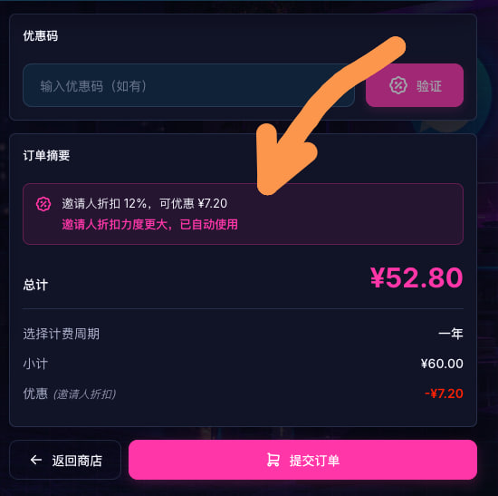
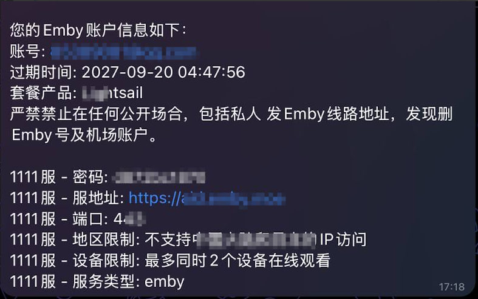
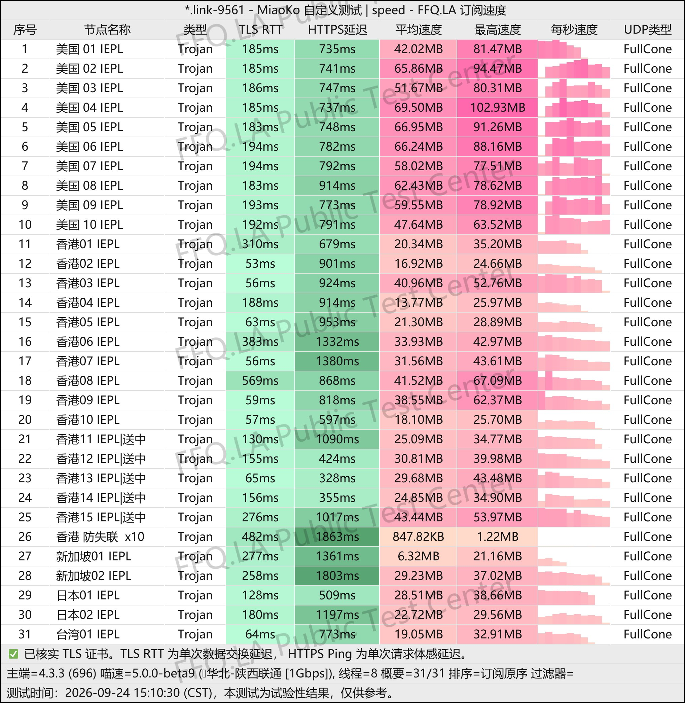
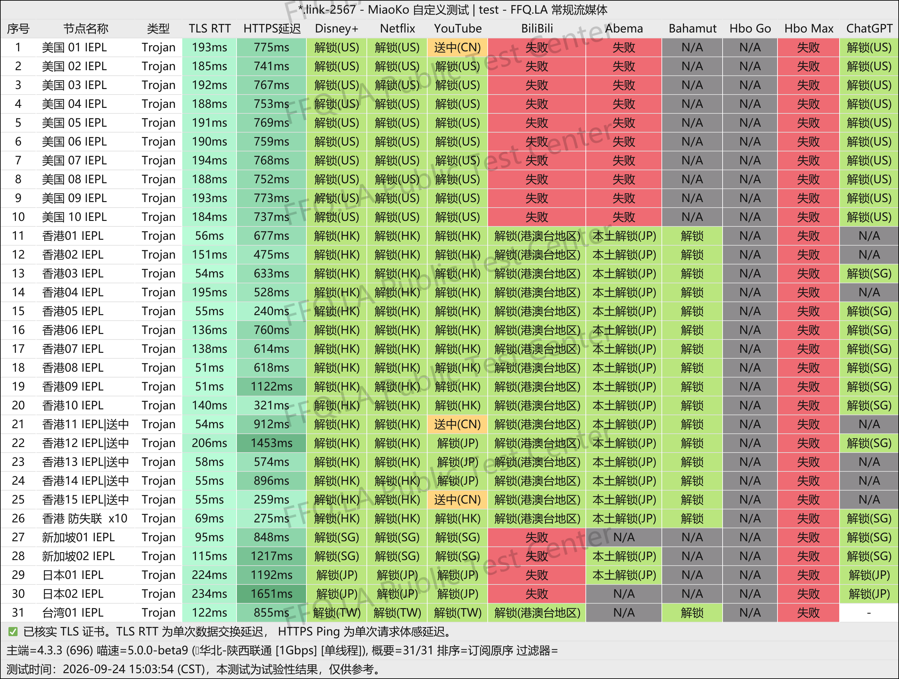
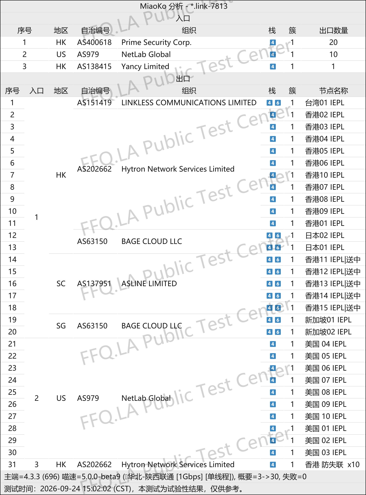

🇨🇳 [中文](README.md) | 🇺🇸 [English](README_EN.md) | 🇷🇺 Русский | 🇮🇷 [فارسی](README_FA.md)

# Официальный сайт KooDog VPN (обновлено 11 ноября 2026)

Официальный сайт KooDog VPN<br>
Официальный адрес: [www.kdcloud.uk](https://to.iix.im/kg01)<br>

Лучшие VPN-сервисы и прокси-серверы 2026 года: [https://github.com/jdnei/JiChangTuiJian](https://github.com/jdnei/JiChangTuiJian)<br>

## Telegram-сообщество VPN #AD

[Группа розыгрышей VPN](https://331024.de/archives/choujiang) | [Чат VPN](https://331024.de/archives/choujiang) | [Группа тестирования VPN](https://331024.de/archives/choujiang)<br>

[https://331024.de/archives/choujiang](https://331024.de/archives/choujiang)

## Пригласительный код

```bash
Q67JjGjy
```

## Промокод / Код скидки

`Скидка 12% при регистрации с пригласительным кодом.`<br>

<br>

## Описание

KooDog VPN — доступный сервис сетевого ускорения, ориентированный на стабильное соединение и гибкие тарифные планы.

Провайдер предлагает различные объёмы трафика для умеренного использования интернета, повседневного просмотра сайтов, потокового видео и интенсивной загрузки данных.

Низкая стоимость начальных тарифов, серверы в популярных регионах и постоянная оптимизация стабильности и скорости подключения делают KooDog подходящим вариантом как для основного, так и для резервного VPN.

## Преимущества

Основные преимущества KooDog VPN — доступные цены, гибкий выбор подписок и невысокая стоимость подключения.

Сервис поддерживает **выделенные сетевые каналы**, обеспечивающие сочетание скорости и стабильности.

Некоторые тарифы позволяют разблокировать популярные стриминговые платформы. Различные объёмы трафика подходят как обычным, так и активным пользователям.

Помимо базовых VPN-подписок, отдельные тарифы включают `доступ к просмотру видео через Emby` и `перенос неиспользованного трафика на следующий месяц`.

В определённые часы также действуют пониженные коэффициенты расхода трафика.

## Тарифные планы

| Тариф | Трафик | Месяц | Квартал | Полгода | 1 год | 2 года | 3 года | Без ограничения срока | Одновременные IP | Обновление трафика | Ограничение скорости | Тип соединения | Emby | Контент для взрослых | Бонус за ежедневный вход | Сниженный коэффициент в непиковые часы | Перенос трафика |
|---|---:|---:|---:|---:|---:|---:|---:|---:|---|---|---|---|---|---|---|---|---|
| Edge Lightsail | 15 ГБ | ¥5 | ¥15 | ¥30 | ¥60 | ¥120 | ¥180 | — | Без ограничений | 1-го числа каждого месяца | Без ограничений | Международные выделенные линии BGP | ❌ | ✅ | ❌ | ✅ | ❌ |
| Lightsail | 50 ГБ | ¥16 | ¥48 | ¥96 | ¥192 | ¥384 | ¥576 | — | Без ограничений | 1-го числа каждого месяца | Без ограничений | Международные выделенные линии BGP | ✅ | ✅ | 1–500M | ✅ | ✅ |
| Lite | 100 ГБ | ¥32 | ¥96 | ¥192 | ¥384 | ¥768 | ¥1152 | — | Без ограничений | 1-го числа каждого месяца | Без ограничений | Международные выделенные линии BGP | ✅ | ✅ | 1–1000M | ✅ | ✅ |
| Basic | 200 ГБ | ¥62 | ¥186 | ¥372 | ¥744 | ¥1488 | ¥2232 | — | Без ограничений | 1-го числа каждого месяца | Без ограничений | Международные выделенные линии BGP | ✅ | ✅ | 1–2000M | ✅ | ✅ |
| Premium | 300 ГБ | ¥88 | ¥264 | ¥528 | ¥1056 | ¥2112 | ¥3168 | — | Без ограничений | 1-го числа каждого месяца | Без ограничений | Международные выделенные линии BGP | ✅ | ✅ | 1–3000M | ✅ | ✅ |
| Pro | 500 ГБ | ¥138 | ¥414 | ¥828 | ¥1656 | ¥3312 | ¥4968 | — | Без ограничений | 1-го числа каждого месяца | Без ограничений | Международные выделенные линии BGP | ✅ | ✅ | 1–4000M | ✅ | ✅ |
| Индивидуальный | 9 999 ГБ | — | — | — | — | — | — | ¥9999 | Без ограничений | 1-го числа каждого месяца | Без ограничений | Международные выделенные линии BGP | ✅ | ✅ | 1–4000M | ✅ | ✅ |

**Сервис недоступен в Синьцзяне, Тибете, Внутренней Монголии и университетских сетях.**

## Коэффициенты расхода трафика в зависимости от времени

🧪 **Пониженные коэффициенты в определённые часы | Соответствующие серверы доступны**

### ⏱️ Коэффициенты списания трафика (пекинское время, UTC+8)

| Временной интервал | Коэффициент расхода |
|---|---:|
| 02:00–08:00 | 0.1× |
| 08:00–16:00 | 0.5× |
| 16:00–02:00 следующего дня | 1.0× |

### 🧮 Примеры

- При использовании **1 ГБ** прокси-трафика с **02:00 до 08:00** из лимита подписки списывается только **0.1 ГБ**.
- При использовании **1 ГБ** прокси-трафика с **08:00 до 16:00** из лимита подписки списывается только **0.5 ГБ**.

> ℹ️ Эти коэффициенты действуют только для серверов в **Гонконге, Сингапуре, Японии, США и Тайване**. Коэффициенты применяются при расчёте расхода трафика. Окончательными считаются данные системы. Об изменениях будет сообщаться на официальном сайте.

## Система переноса неиспользованного трафика

### 🔄 Что такое перенос трафика?

Неиспользованный трафик предыдущего месяца может быть **перенесён на следующий месяц**, что продлевает возможность его использования ещё на один расчётный период.

### 🚀 Система переноса трафика

- После **истечения срока подписки** остаток трафика аннулируется. После повторной покупки или продления подписки перенос трафика начинает действовать **со следующего месяца**.
- Во всех периодических тарифах трафик обновляется **1-го числа каждого месяца**, независимо от даты первоначальной покупки.
- Если для тарифа **не предусмотрена функция «Перенос трафика»**, неиспользованный остаток не переносится. При этом основной лимит по-прежнему обновляется 1-го числа каждого месяца.

### 🧮 Примеры

#### Январь

Лимит подписки: **100 ГБ**

Неиспользованный остаток: **50 ГБ**

→ **Доступно 1 февраля: 150 ГБ**

#### Февраль

Если в феврале трафик вообще не расходовался:

- **50 ГБ, перенесённые из января, сгорают.**
- **100 ГБ февральского лимита остаются неиспользованными.**

→ **Доступно 1 марта: 200 ГБ**

#### Март

Общий доступный трафик: **200 ГБ**

- Базовый месячный лимит: **100 ГБ**
- Неиспользованный трафик, перенесённый из февраля: **100 ГБ**

> ℹ️ Перенесённый трафик действителен только **в течение следующего месяца**. Остатки, перенесённые из более ранних месяцев, сгорают. Окончательный расчёт производится системой; изменения публикуются на официальном сайте.

## Руководство по Emby

<br>

<br>

### 🎬 @GreatEmby_bot | Бот управления Emby и рекомендации плееров

### 🤖 Инструкция по использованию бота

1. Используйте `/synchronizer` для синхронизации всех сервисов Emby, подключённых к KooDog.
2. Затем выполните `/info`, чтобы получить данные для входа.
3. Если синхронизация завершилась ошибкой, отправьте обращение в поддержку с описанием ошибки.
4. Перед началом воспроизведения обычно требуется **3–10 секунд** предварительной загрузки. Пожалуйста, подождите.

### ⚠️ Важные замечания

- Значение пароля `None` означает, что вход возможен без пароля.
- Ошибка **401** указывает на неправильный пароль. Используйте `/resetpassword`, чтобы изменить его.
- Ошибка **403** означает региональное ограничение. Используйте `/info`, чтобы проверить разрешённые регионы сервера.
- Если подписка активна, но медиатека пуста, сначала выполните `/synchronizer`, чтобы обновить права доступа и содержимое медиатеки.

### ⛔ Запрещённые плееры (не используйте)

- Baomihua (爆米花)
- Vidhub
- Infuse в режиме «Media Library Mode»
- Reflix
- Вход через Emby for Kodi

### ⬇️ Загрузка плееров

> В качестве протокола подключения выберите **«Emby»** или **«Other Emby»**.

### 🍎 Рекомендации сообщества (устройства Apple)

- **SenPlayer:** Рекомендуемый платный вариант для устройств Apple. Базовое приложение бесплатное, имеются встроенные покупки.
- **Infuse:** Работает на различных устройствах Apple и отличается качественным декодированием видео. При добавлении Emby обязательно отключите «Server Mode».
- **Conflux:** В настоящее время бесплатный, поддерживает несколько платформ и может служить альтернативой Infuse.

### 🤖 Рекомендуемые плееры (Android / Windows)

- **Hills:** Базовое приложение бесплатное, есть встроенные покупки. В бесплатной версии относительно мало ограничений, основные функции воспроизведения доступны.
- Пользователи Windows могут найти и установить программу непосредственно из Microsoft Store.
- Пользователи Android могут скачать приложение из Google Play или официального канала разработчика.

### 📱 iOS / iPadOS

- **Infuse** → [**Скачать**](https://apps.apple.com/cn/app/id1136220934)
- **yybx** → [**Скачать**](https://apps.apple.com/cn/app/yybx/id1519723194)
- **iemc** → [**Скачать**](https://apps.apple.com/cn/app/iemc/id1467462861)
- **Fileball** → [**Скачать**](https://apps.apple.com/cn/app/fileball/id1558391784)
- **HamHub** → [**Скачать**](https://apps.apple.com/cn/app/id6458691598)
- **SenPlayer** → [**Скачать**](https://apps.apple.com/cn/app/id6443975850)
- **Conflux** → [**Скачать**](https://apps.apple.com/cn/app/conflux-video-player/id6450330892)
- **iPlay** → [**Скачать**](https://apps.apple.com/cn/app/iplay/id6480576133)
- **Forward** → [**Скачать**](https://apps.apple.com/us/app/forward-%E6%96%B0%E8%A7%86%E7%95%8C/id6503940939)

### 📺 Apple TV

- **Infuse** → [**Скачать**](https://apps.apple.com/cn/app/id1136220934)
- **yybx** → [**Скачать**](https://apps.apple.com/cn/app/yybx/id1519723194)
- **Fileball** → [**Скачать**](https://apps.apple.com/cn/app/fileball/id1558391784)
- **HamHub** → [**Скачать**](https://apps.apple.com/cn/app/id6458691598)
- **SenPlayer** → [**Скачать**](https://apps.apple.com/cn/app/id6443975850)
- **Conflux** → [**Скачать**](https://apps.apple.com/cn/app/conflux-video-player/id6450330892)
- **iPlay** → [**Скачать**](https://apps.apple.com/cn/app/iplay/id6480576133)

### 🤖 Android

- **Afusekt** → [**Скачать**](https://github.com/AttemptD/AfuseKt-release/releases)
- **Yamby** → [**Скачать**](https://t.me/yamby_release)
- **Emby 小秘 / Сборник модифицированных версий** → [**Скачать**](https://t.me/NaoRubbish/119)
- **iPlay** → [**Скачать**](https://github.com/ourfor/iPlay/releases)
- **Jellyfin** → [**Скачать**](https://play.google.com/store/apps/details?id=org.jellyfin.mobile&hl=en_US)
- **Findroid** → [**Скачать**](https://play.google.com/store/apps/details?id=dev.jdtech.jellyfin&hl=en_US)
- **Emby kirlif** → [**Скачать**](https://t.me/SaltSoupGarage/603)
- **Femor** → [**Скачать**](https://t.me/hkaemby/38362)

### 📺 Android TV

- **Afusekt TV** → [**Скачать**](https://github.com/AttemptD/AfuseKtV-release/releases)
- **Jellyfin Android TV** → [**Скачать**](https://github.com/jellyfin/jellyfin-androidtv/releases)
- **Emby 小秘 / Сборник модифицированных версий** → [**Скачать**](https://t.me/NaoRubbish/119)
- **Emby kirlif** → [**Скачать**](https://t.me/SaltSoupGarage/615)

### 🖥️ Windows

- **Jellyfin Media Player** → [**Скачать**](https://github.com/jellyfin/jellyfin-media-player/releases)
- **Emby 小秘 / Сборник модифицированных версий** → [**Скачать**](https://t.me/NaoRubbish/119)
- **Tsukimi** → [**Скачать**](https://github.com/tsukinaha/tsukimi/releases)
- **Femor** → [**Скачать**](https://t.me/hkaemby/38362)

> 💡 Совместимость приложений с различными устройствами и модифицированными версиями может существенно отличаться. Рекомендуется попробовать несколько плееров и выбрать наиболее удобный для вашего устройства.

## 📊 Тестирование производительности и анализ

#### 1. Тест скорости в вечерние часы пик

<br>

#### 2. Отчёт о разблокировке стриминговых сервисов

<br>

#### 3. Анализ входных и выходных узлов

<br>
